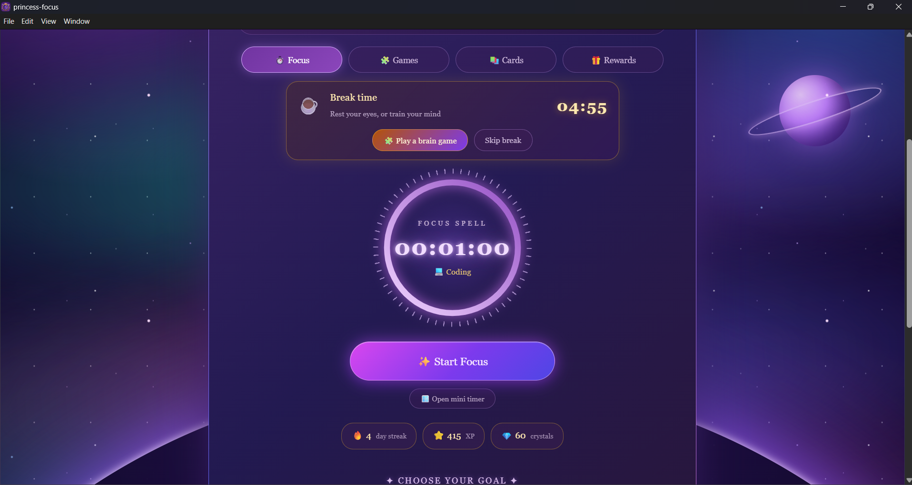
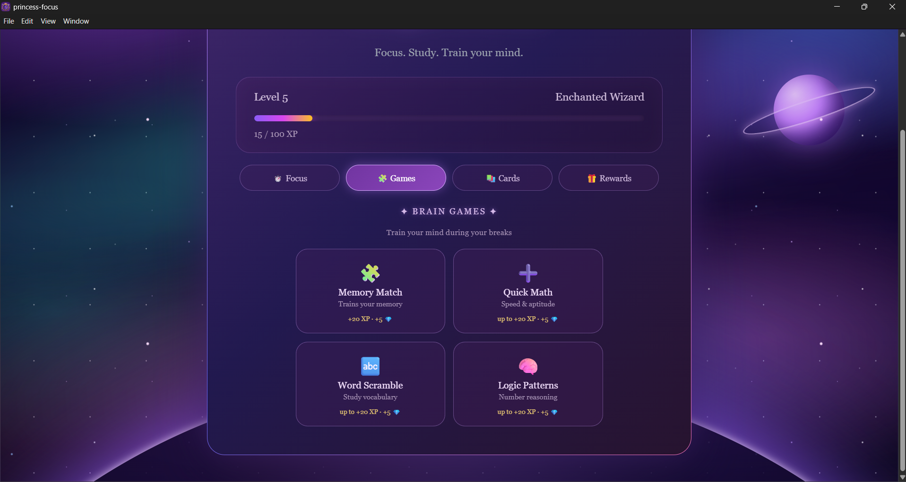
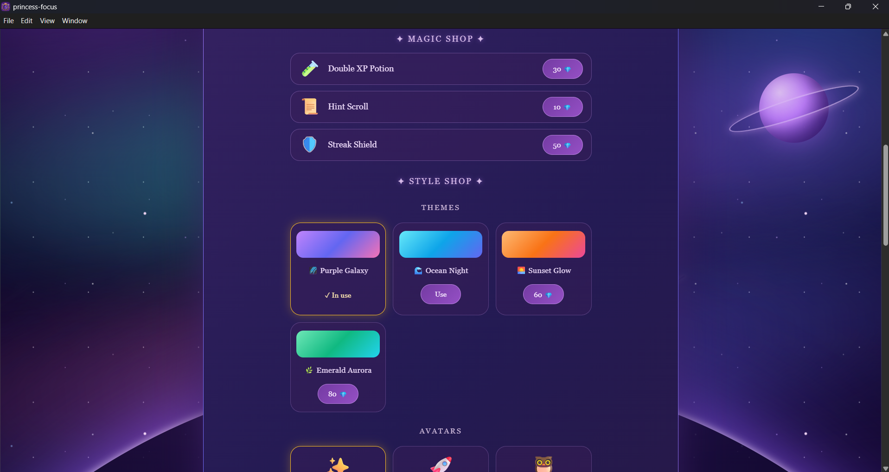
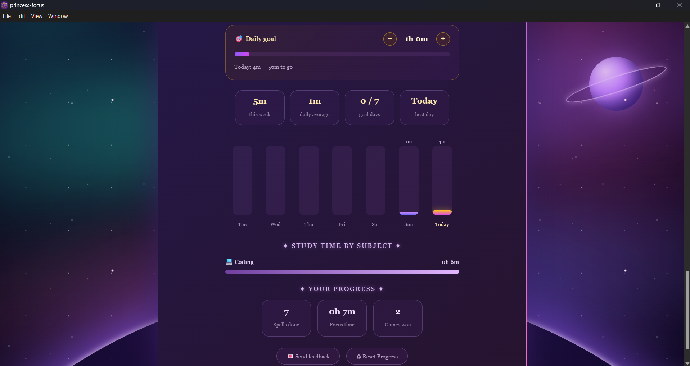

# ✨ Magic Focus

A desktop focus and study app for Windows that helps you concentrate, study smarter and train your mind with brain games. Finish focus sessions to earn XP, crystals, streaks and rewards.

**[⬇ Download for Windows (v1.0.0)](https://drive.google.com/file/d/13kuamEf8ipsbnP2scWfJeriPAjy1Ag80/view?usp=drive_link)**

> Windows may show a "Windows protected your PC" box because the app is not signed. Click **More info → Run anyway**.
## Screenshots

<p align="center">
  
</p>
<p align="center">
  
</p>
<p align="center">
  
</p>
<p align="center">
  
</p>

## Features

- **Focus timer** with a progress ring and preset goals for Employee, Student and Govt Exam
- **Subject tracking** to log your study time by subject
- **Break time** after each session, with a mystery gift and a break countdown
- **4 brain games:** Memory Match, Quick Math, Word Scramble and Logic quiz
- **Flashcards** to add your own questions and revise them in 3 boxes
- **Progress system** with XP, levels, crystals, day streaks and streak shields
- **Rewards shop** with potions and hint scrolls
- **Style shop** to unlock themes and avatars with crystals
- **Weekly chart and daily goal** to see how much you studied
- **Relaxing sounds:** Ocean, Calm and Zen, generated in the app
- **Mini timer** in a small separate window
- **Desktop notifications** when a session finishes
- **Feedback button** that opens an email to the developer

## Built with

- React 19 and Vite
- Electron and electron-builder (Windows installer)
- Web Audio API for sounds (no audio files)
- localStorage to save progress on your computer
- Vitest and Testing Library for tests

## Run it yourself

```
git clone https://github.com/shuruthiMCA/magic-focus.git
cd magic-focus
npm install
npm run dev
```

To build the Windows installer:

```
npm run dist
```

The installer is created in the `release` folder.

## About

Built by Shuruthi as a personal project to learn React and Electron and to help people focus.